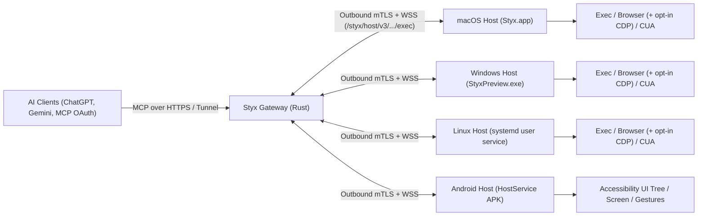

<div align="center">
  
  <h1>Styx</h1>
  <p>
    Connect ChatGPT, Google Gemini, and MCP OAuth clients to your macOS, Windows, Linux, and Android devices through one self-hosted Gateway.
  </p>
  <p>
    <a href="https://github.com/sidnvy/Styx/releases/latest">
      
    </a>
    <a href="LICENSE">
      
    </a>
    
    
  </p>
  <p>
    <a href="#capabilities">Capabilities</a> &middot;
    <a href="#architecture">Architecture</a> &middot;
    <a href="#quick-start">Quick Start</a> &middot;
    <a href="#security--verification">Security</a> &middot;
    <a href="#development">Development</a> &middot;
    <a href="#documentation">Docs</a>
  </p>
</div>

---

Styx splits device control into one self-hosted **Gateway** (MCP ingress, authentication, and device routing) and lightweight **Host** connectors running natively on the machines and phones you authorize. Devices connect **outbound** to your Gateway, and each Host decides locally which capabilities are enabled.

## Capabilities

| Capability | Backing Executor | Behavior & Isolation | Platforms |
| --- | --- | --- | --- |
| **Commands (`Exec`)** | OpenAI Codex Exec Server | Interactive shell sessions (`exec_command`, `write_stdin`, task control) owned by the Host across chat disconnects | macOS, Windows, Linux |
| **Browser Automation** | Bounded Playwright Worker | Persistent isolated Chromium profiles per Host (retained across conversations/restarts), plus opt-in local Chrome CDP attachment (`existing-browser`, off by default, non-destructive detach) | macOS, Windows, Linux |
| **Computer Use (`CUA`)** | TryCua `cua-driver` + OS Accessibility bridges | Accessibility-tree reads, targeted input, and screen capture through native OS APIs | macOS, Windows, Linux (Wayland/Hyprland & XWayland) |
| **Android Control** | Kotlin/JNI Accessibility Host (`HostService`) | Accessibility UI trees, scaled screenshots, node actions, gestures, and multi-display support (`android_list_displays`, `android_observe`, `android_act`, `android_run_steps`) | Android (`arm64`) |

### Clients & Multi-Device Routing

- **Many-to-many topology**: one AI conversation can target several paired Hosts using explicit `environment_id` routing, while multiple concurrent conversations can share the same Host with isolated Browser profiles and independent caller leases.
- **Supported AI clients**:
  - **ChatGPT** via the Gateway's native Secure MCP Tunnel (`styx gateway tunnel`).
  - **Google Gemini & standard MCP OAuth clients** via the Gateway's native `PublicMcp` HTTPS/OIDC ingress (`styx gateway public-mcp`).

## Architecture



### Core Design Invariants

1. **Outbound-only Hosts** — Paired Hosts initiate outbound WebSocket connections over pinned TLS to your Gateway; laptops, desktops, and phones never expose inbound ports.
2. **Host-local capability authority** — Pairing grants identity only. Enabling, disabling, or configuring `Exec`, `Browser`, `Computer Use`, `Android`, and local Chrome `CDP` (`browser-cdp.json`) happens solely on the Host itself.
3. **Truthful execution semantics** — Styx separates transport errors from execution state and never silently replays state-changing operations whose outcome is `unknown`.
4. **Desktop & task lifetime separation** — Closing a chat releases caller access while preserving Host-owned Exec tasks and saved Browser profiles until explicitly closed, disabled, or stopped.

## Quick Start

### 1. Download Official Packages

Download signed release assets and checksums from [GitHub Releases](https://github.com/sidnvy/Styx/releases/latest):

| Platform | Asset | Supported Roles |
| --- | --- | --- |
| macOS (Apple Silicon) | `Styx-<version>-macos-arm64.dmg` | Host, or Gateway + Host |
| Windows x64 | `Styx-<version>-windows-x64.exe` | Host, or Gateway + Host |
| Linux x86_64 Desktop | `styx-<version>-linux-x86_64-desktop.tar.gz` | Host, or Gateway + Host |
| Linux x86_64 Server | `styx-<version>-linux-x86_64-gateway-only.tar.gz` | Headless Gateway only |
| Android `arm64` | `Styx-<version>-android-arm64.apk` | Android Host |

Verify checksums before installing:

```sh
sha256sum -c SHA256SUMS
```

### 2. Set Up a Gateway & Pair Devices

1. **Initialize one Gateway** on a desktop app or a headless Linux server (`./install.sh`, then `styx setup`), and configure either the ChatGPT Secure MCP Tunnel or `PublicMcp`.
2. **Create a one-use invitation** on the Gateway (`styx invite` or the app UI).
3. **Join each Host** using the Gateway URL and short pairing code, then approve the pending device on the Gateway.
4. **Enable local capabilities** on each Host. To opt in to attaching your existing Chrome window (`existing-browser`), enable remote debugging in Chrome (`chrome://inspect/#remote-debugging`) and run:

   ```sh
   styx host browser-cdp enable
   ```

See [INSTALL.md](INSTALL.md) for platform-specific installation, systemd linger notes, service controls, and clean in-place upgrades.

## Security & Verification

- **Pairing & Transport**: Devices enroll using SPAKE2 short-code verification, authenticate over pinned Gateway-CA TLS (`v1.2`/`v1.3`) and mTLS/WSS, and store keys privately inside OS-protected directories (`AndroidKeyStore` on Android).
- **Signed Runtime Manifests**: Runtime payloads are verified at install/upgrade against Styx's Ed25519 publisher key (`styx-publisher.pub` in every GitHub Release; SPKI SHA-256 `bbb49c2626c3d4ef3cf9e1679db5305b100cee4a8c41c29c958ede82fb868bed`).
- **Android APK Signing**: Release APKs use APK Signature Scheme v2/v3 with fixed certificate SHA-256 `a83c569e96981ce31d6ad50dace6094c1f644be7b0a09c3fe84addc74af4b7b3`, allowing in-place upgrades while keeping existing pairings and permissions.
- **OS Code Signing Disclosure**:
  - `Styx.app` on macOS is signed with Styx's release signing certificate and is not notarized with an Apple Developer ID.
  - `Styx-<version>-windows-x64.exe` is not Authenticode signed; Styx runtime publisher verification still enforces payload integrity at install time.

## Development

Canonical product source lives strictly under [`src/`](src/) (`src/crates/*`, `src/host/*`, `src/providers/*`).

### Prerequisites

- **Rust**: toolchain pinned in [`rust-toolchain.toml`](rust-toolchain.toml) (`1.97.1`)
- **Node.js**: v22+ (for Playwright browser worker, packaging scripts, and contract checks)
- **Android builds** *(optional)*: Android SDK API 36, NDK 29, JDK 21, and `aarch64-linux-android` target

### Common Commands

```sh
# Install JS dev/worker dependencies under src/
npm --prefix src ci --ignore-scripts --no-audit --no-fund

# Check & test the Rust workspace
cargo check --locked --offline --workspace
cargo clippy --locked --offline --workspace --all-targets -- -D warnings
npm run test:unit
npm run test:contracts

# Build and run the CLI from source
npm run styx -- --help
npm run gateway -- --help
```

See [VALIDATION.md](VALIDATION.md) for the complete verification and quality gate instructions.

### Repository Layout

```text
.
├── Cargo.toml / Cargo.lock        # Workspace manifest (styx, styx-runtime, styx-core, styx-contracts, styx-android)
├── src/
│   ├── crates/                    # Rust Gateway, Host, Core ledger/policy, CLI, and Android JNI crates
│   ├── host/                      # Native Swift macOS app, C# Windows tray/UI app, Kotlin Android app
│   ├── providers/                 # Bounded Playwright browser worker & TryCua CUA native integration
│   ├── ci/                        # Release orchestration, quality gate, Linux/Android/desktop packagers
│   └── docs/                      # Architecture, contracts, release runbooks, and delivery specs
├── INSTALL.md                     # Platform setup, pairing, and upgrade guide
├── VALIDATION.md                  # Local test suites and quality gates
├── THIRD_PARTY.md                 # Upstream runtime and dependency notices
└── LICENSE                        # MIT License
```

## Documentation

- [Installation, pairing & upgrades](INSTALL.md)
- [Validation & test suites](VALIDATION.md)
- [Architecture & ownership boundaries](src/docs/architecture.md)
- [Confirmed product scope](src/docs/rust-core-rewrite/REFACTOR-PLAN.md)
- [Public MCP tool contract (`PUBLIC-MCP-V1.json`)](src/docs/rust-core-rewrite/PUBLIC-MCP-V1.json)
- [Android Host architecture & build](src/host/android/README.md)
- [Releasing procedure](src/docs/RELEASING.md)
- [Third-party notices](THIRD_PARTY.md) &middot; [MIT License](LICENSE)
