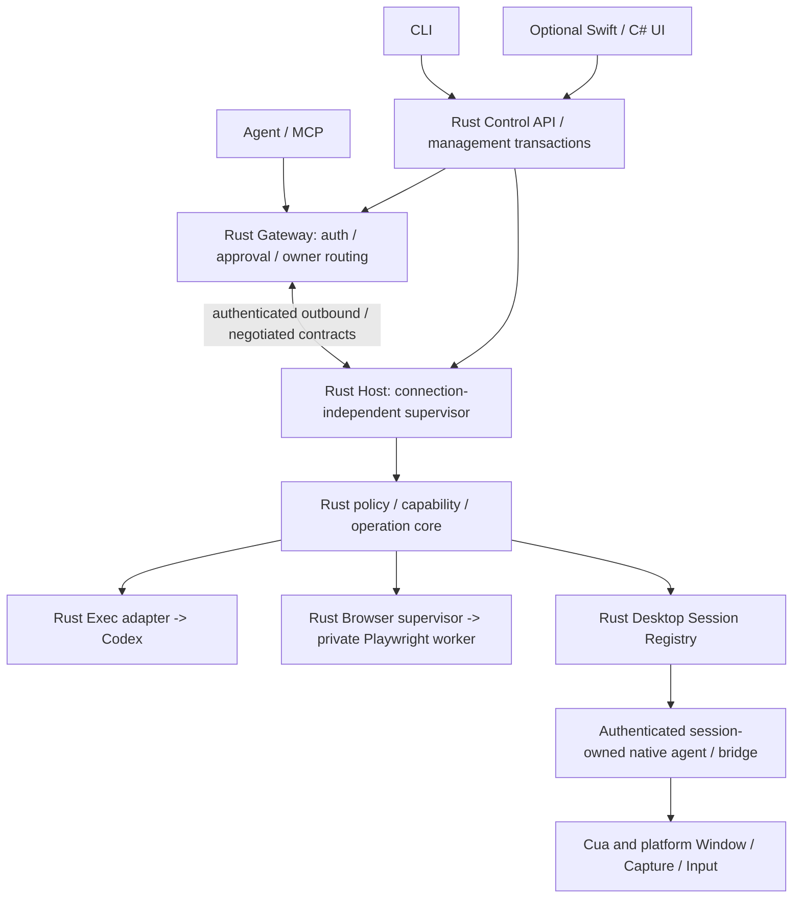

# Styx Rust Core Rewrite — implementation specification

2026-10-24 · draft-1 / owner-directed execution baseline

行为参考源码：`44cf1470e6b0cfdfd2c2372e54e84ebd279c59c3`。本轮是plan/spec，没有Rust实现/新包/部署声明。详细合同见[CONTRACTS.md](CONTRACTS.md)，任务见[EXECUTION-PLAN.md](EXECUTION-PLAN.md)。

## 1. Objective and completion boundary

将Styx自有的核心运行、管理、策略和协议实现迁入Rust，并用明确的责任、故障域、状态机和真实验收完成迁移。接受用户的技术方向，不再用既有JS工作量作为保留JS核心的理由。Rust的静态类型、资源所有权和原生部署是工程手段；它们不自动证明权限正确、子进程退出或网络动作只执行一次。

最终交付必须满足：

- CLI、Gateway、Host、Shared Core和Styx自有adapter/管理逻辑为Rust；正常运行与恢复不依赖旧JS Core。
- GUI可选，headless Exec和headless Browser不需要图形session；Desktop Session变化不影响其余能力。
- 身份、配对、publisher pin、原生权限责任、配置和登录状态有可验证迁移路径，不重新建立一套信任关系。
- 自有配置、授权、操作、会话和更新只有一套权威，没有Rust外壳下继续运行的JS管理核心。
- 所有必需场景闭合且绑定同一候选的逐目标/模式实例；正式签名、首次账号和原生边界缺证据就明确未完成。

不增加UI重设计、多租户、任意Browser attach/CDP、Agent推理层或通用持久自主任务。已有CAS实验按独立冻结基线保存，不塞入新核心默认运行链；若后续需要集成，另列明确Rust迁移任务，不遗留隐藏JS服务。

## 2. Rewrite / retain / retire

| 类别 | 本轮决定 |
| --- | --- |
| Gateway自有代码 | Rust重写MCP/HTTP/WSS控制面、认证、owner路由、enrollment/self-device CAS、registry、撤销和准入。复用成熟协议库。 |
| Host自有代码 | Rust重写outbound、provider监督、维护围栏、session目录、重连与结构化状态；executor寿命不再由一次socket连接决定。 |
| 管理Core与CLI | Rust重写配置验证、计划、状态/权限投影、能力编辑、安装/更新/回滚/恢复事务、服务owner和退出控制。GUI/CLI调用同一API。 |
| Styx执行adapter | Rust拥有Exec句柄/owner/cursor/取消/未知结果，Cua目标/快照权威和排队，Browser lease/profile/引用/恢复政策。 |
| Codex / Cua | 保留固定版本成熟外部二进制及原生协议；不重写PTY、屏幕引擎或上游执行器。纳入hash、来源、合同验证。 |
| Playwright / Node | Playwright作为外部执行器。必要Node worker只做受控Browser调用，不拥有产品配置/配对/授权/journal/owner判定。无系统全局Node或运行时下载依赖。 |
| Swift / C# | 保留UI和经过验证的OS授权、签名责任、原生会话API桥；业务决策移Rust。可以保留构建/安装脚本，不能让脚本成为第二套运行权威。 |
| JS Core | 仅在隔离迁移/差分基线使用，最终active loader、普通CLI、Gateway和Host路径移除。兼容不是长期双实现。 |

最终包的headless-only配置不需要Node；只有安装Browser能力才包含固定Node/Playwright闭包。能够禁用Browser而正常运行Gateway/Host/Exec是验收门槛。前端展示脚本不等于核心策略，仍不得写权威状态。

## 3. Target architecture and Rust workspace

### 3.1 Runtime responsibilities



管理Core与执行Core是共享规则/ports的两种组合，不是两套状态数据库。Gateway不经本机GUI对象路由；Host可没有Desktop Agent。实际部署可Gateway-only、Host-only或两者同机。Agent/模型选择能力，Core不理解任务语义或做隐式智能fallback。

### 3.2 Four crates, explicit module ownership

```text
Cargo.toml / Cargo.lock / rust-toolchain.toml
src/crates/
  styx-contracts/src/{ids,error,capability,session,operation,protocol,legacy_codec}.rs
  styx-core/src/{policy,router,operation,admission,ports}/
               management/{deployment,plan,transaction,recovery,update}/
  styx-runtime/src/{gateway,host,storage,ipc,providers,platform}/
  styx/src/{main,cli,daemon,composition}.rs
src/providers/browser-worker/          # only if an upstream bridge is necessary
src/host/macos/ and src/host/windows/   # existing native bridges/UI, no rename for appearance
src/plugin/                           # protocol-facing assets/skills updated to actual contract
```

代码依赖只能向内：`styx → runtime → core → contracts`；runtime可直接使用contracts。contracts只有纯类型/codec；core只有政策、状态转换与port trait，不importTokio、fs/net/AX/UIA/Hyprland/Playwright对象；runtime实现IO和OS adapter；binary只组合，禁止重做授权规则。Cargo workspace共享锁/工具链，crate不是进程。[Cargo官方说明](https://doc.rust-lang.org/cargo/reference/workspaces.html)

不引入独立RPC服务来连接同进程crate。模块注册文件、根manifest/lock由集成者维护；平台和provider子目录可并行。每个模块有责任说明和contract引用，避免以行数或“全部放进runtime”代替模块化。

### 3.3 Implementation defaults

Rust stable/edition2024，R01固定具体版本和MSRV并验证所有目标SDK。默认候选库：Tokio、serde/serde_json、thiserror、clap、tracing、rustls、官方rmcp；每项在R01通过协议/平台/许可证/供应链验证后写锁，不能自动取latest。rmcp官方SDK已有实现，先验证冻结MCP版本/headers/tool schema，不借SDK升级扩大产品能力。[官方Rust MCP SDK](https://github.com/modelcontextprotocol/rust-sdk)

网络/子进程IO异步；文件hash/有限CPU工作进入有界blocking pool。不能把无限同步probe放进async task，或以abort JoinHandle代替停止OS动作。Tokio明确说明已启动的spawn_blocking不可被abort，需设计实际deadline/退出证据。[Tokio说明](https://docs.rs/tokio/latest/tokio/task/fn.spawn_blocking.html)

业务路径使用类型化Result，禁止panic/unwrap作为正常错误处理。unsafe默认deny，只在隔离OS FFI模块逐项说明安全条件并审查。禁止手写密码算法；TLS、RSA legacy兼容、Ed25519 publisher分别选用成熟固定依赖或平台API。

### 3.4 CLI / management API surface

单一`styx`入口的命令族：`gateway run`、`host run`、`desktop-agent run`、`status/doctor --json`、`sessions list/inspect/attach/detach`、`plan/apply/recover/rollback`、`host stop/pause/resume`、`service status/install/enable/disable`及`operation inspect/cancel`。这是R00要冻结的命令族，不要求按名字重做成熟功能；现有普通CLI参数/输出需明确兼容映射，不能静默少实现一半管理功能。

所有管理命令进入同一Rust Control API；`--json`返回带schema版本和结构化错误的结果，exit code区分成功、确定拒绝、需授权/不可用和Unknown/待协调。stdout为协议/用户输出，诊断写脱敏stderr；凭据不能从argv传入。profile/endpoint按受信私有配置发现，不接受远端传任意socket或binary。CLI与GUI均不能直接写权威文件绕过API和writer lease。

operation inspect/cancel管理当前执行与未知状态，不引入通用长期任务scheduler。daemon/worker内部模式不是默认暴露的网络管理API。名称/codec在R00冻结，变更有兼容表和用户可见说明。

## 4. Process, lifetime and user-visible policies

### 4.1 Separate three lifetimes

Host：Installed→Starting→Ready→Connected/Disconnected→Stopping。Desktop：Absent→Discovered→Connecting→Ready/Degraded/AuthorizationRequired→Disconnected/Revoked/Terminated。Operation：Created→Validated→Dispatched/Running→Succeeded/Failed/Cancelled/Unknown。

会话lock/logout/compositor/agent死亡只撤销相关Desktop generation及其排队工作；in-flight按证据报告结果或Unknown，不能重放。身份/签名/配置scope损坏是全Host fail-closed。Provider crash、网络断线、UI超时、更新fence都有单独错误域。

### 4.2 Management ownership and Quit

固定三种显式manager：foreground CLI、App-managed compatibility、persistent service。迁移保留既有模式与desired-state，不静默把原前台配置提升成常驻服务。

- 关闭设置窗口只隐藏/退出该窗口。
- App-managed兼容模式的显式Quit继续停止它拥有的组件；独立service不受误停。
- persistent模式中GUI是client，Quit退出UI；如果UI进程也承载Desktop Agent，只撤销该会话的Desktop能力，Exec/headless Browser继续。
- Stop Host为明确管理动作：fence新任务→观察活任务/Unknown→按已授权drain/cancel策略处理→确认自有进程退出→持久stop receipt。不能关闭IPC后就报告完成。
- 禁用autostart与立即Stop不同；用户明确stop写desired-state，监督器不能立刻复活。所有停止/恢复保留身份和配对。

新安装应展示实际管理模式和Quit影响；不增加首装技术选项页。默认持久性选择由R02形成可行方案并在R38关闭具体身份/安装决定，既有配置迁移不改语义。新增信任身份或凭据存储不由agent隐式决定。

### 4.3 Platform topology and persistence truth

| 平台 | Host / Desktop方案 | 必须关闭的条件 |
| --- | --- | --- |
| Linux Arch/Hyprland | 普通用户systemd service归default.target；Desktop Agent按logind/seat/compositor session绑定，经私有IPC注册。可复用Cua child，独立agent只在明确边界需要。 | user manager不天然属于某图形session；跨最后一次logout需明确linger政策。不得自动sudo/启linger或全局export显示变量。 |
| macOS ARM/x64 | Rust Host作为无GUI服务；保留原签名App/native agent拥有TCC与embedded Cua。CLI可操作headless能力，不启动授权UI。 | gui域LaunchAgent不能当作跨logout服务。persistent模式跨完整logout是required gate，需在R02验证以普通用户运行的受支持服务注册、home/key可用性；系统域注册可需安装授权，但执行不以root。 |
| Windows x64 | Rust Host无交互会话依赖；Desktop Agent在目标普通用户Session内。Named Pipe与SID/LUID/session/integrity绑定。 | InteractiveToken任务只在已登录会话运行；跨logout需合法非交互服务身份。不得自动改为SYSTEM，也不把S4U视为免费保留网络/加密文件能力。 |

必须报告`lifetime_scope: process | user_login | machine_boot`及`survives_logout: true/false/unknown`。Desktop退出隔离始终是必需场景；persistent模式跨完整用户logout持续服务是重写完整交付的required gate，必须原生PASS，不能通过不声明支持免除。App-managed兼容模式不能替代该门槛。若macOS/Windows需要新的服务账户、管理员注册或凭据方案，R02给出可审方案/具体影响，R38关闭必要决定；该门槛不能以“Rust已实现”绕过，也不阻塞其他代码并行。Windows官方明确区分InteractiveToken和S4U限制。[TASK_LOGON_TYPE](https://learn.microsoft.com/en-us/windows/win32/api/taskschd/ne-taskschd-task_logon_type)

## 5. Capabilities, targets and providers

C01–C08是实施合同草案，R00冻结为v1。原则是类型化状态代替散落bool，OS事实代替环境猜测，Target+Generation代替裸窗口/PID引用。

Exec不自动注入Desktop Agent发现的全局环境；允许受授权命令继承自身原生allowlist环境。继续使用Codex协议的PTY、stdout/stderr、cursor、exit/EOF和writeId语义。Host网络重连保留executor并按原owner验证续取，不跨owner接管；Host重启后的任意job持续运行不作无证据承诺。

Browser Rust supervisor拥有owner/profile/引用代次、URL/文件政策、队列和未知结果恢复。Node worker不持配对/admin key或产品journal；可替换且受有限协议监督。profile和网站登录状态是受保护状态。一个managed context属于owner，不共享上游“当前tab”。worker失败只影响Browser；headless无需桌面，headed需要C03明确绑定。Playwright官方MCP依赖Node，这是外部依赖边界，不保留JS Core的理由。[Playwright MCP](https://github.com/microsoft/playwright-mcp)

Desktop按Window、Capture、Input、可选Accessibility报告实际支持。保留成熟Cua和原生桥；不要求本轮同时实现Portal/PipeWire/libei/AT-SPI所有路径。Hyprland是首个Linux原生验收目标，Shared Core不含其环境或IPC逻辑。显示器热插拔使受影响target/observation失效，不能把旧坐标搬到另一屏幕。

## 6. Security invariants — release blockers

1. 远程设备批准、MCP owner、OS本机会话权限分离；新工具参数不能自赋owner/session或指定任意socket/binary。
2. 显式目标失效不得fallback；多候选返回歧义；同UID socket所有权不证明其与logind session关联。
3. 旧snapshot/element/window/Session generation不得用于新实例；动作dispatch前重新验证批准和目标。
4. 超时、掉线、kill worker、取消ack均不证明动作未执行；Unknown不自动重放。
5. 配置根/设备identity只一个有效owner/writer；维护fence先于新dispatch；撤销后排队工作不能继续。
6. 私钥、token、invite、屏幕原文、剪贴板和输入内容不进默认日志/argv/包；诊断只记录结构与脱敏hash。测试使用合成秘密验证泄漏。
7. signed manifest覆盖入口、Rust payload、native桥和所有worker/executor；拒绝篡改、路径穿越、symlink/reparse和版本混用。
8. Rust worker/async取消必须验证实际子进程/任务终态；只清理自己持有且kernel identity匹配的资源，不按进程名杀用户程序。
9. 同一用户账户内的恶意代码不是本轮声明可完全隔离的安全边界；仍按最小暴露面保护IPC，不能过度宣称sandbox。

任何安全不变量失败都不能被性能改进或通过测试数量抵消。

## 7. Migration and removal of the JS core

> **Superseded 2026-10-27:** the migration gates in §7.1–7.2 are out of the release scope. See [REDUCED-SCOPE.md](REDUCED-SCOPE.md). JS core removal (gate 5's last step) remains.

### 7.1 New implementation, preserved trust

旧代码是行为/缺陷/证据来源，不是新结构模板。仅保留有外部兼容价值的合同：公开工具、设备身份、配对签名、publisher/CA、必要的CLI与状态迁移。内部组织和状态schema可以明确改变，必须有版本、迁移和恢复。

R00盘点所有对外CLI/Control/MCP方法并分类required、intentional change、experimental deferred；不能只实现happy-path exec后宣称重写完成。现有CAS实验保存冻结ref与证据；本轮普通产品能力不扩大。

### 7.2 Five migration gates

1. **Read-only import**：Rust读取现有状态及原始bytes，验证身份/权限/配置/locks/journal；不格式化或写入生产profile。
2. **Mixed-runtime interop**：旧Gateway→Rust Host、Rust Gateway→旧Host、Rust→Rust分别在隔离root验协议。旧端不具备新会话保证时明确compatibility/unsupported，不能假造能力。
3. **Signed installer/loader**：先完成runtime_format与新bootstrap验证。旧loader固定JS入口；通过新原生installer或一次签名bridge引入Rust，不让旧Core直接加载不认识的格式。最终bridge退出。
4. **Single-owner cutover**：备份/校验→fence→确认work与事务结算→旧owner释放→新owner取同root lease→激活verified payload→读取协调/真实操作验证→commit。执行liveness未知或未协调事务阻止切换，不force清lock；已终止但副作用结果Unknown的历史记录保持Unknown并随状态迁移，不能永久等同活任务或伪造取消。
5. **Rollback / removal**：可逆状态与代码回滚分别验；不还原已撤销授权或覆盖新状态。reader barrier拒绝不兼容旧版。Rust全场景通过后，从active product source/package/commands删除旧JS Core，保留Git历史与基准archive，不保留永久fallback。

需要保留的不是所有历史路径。Mac/Windows包内旧vnext布局由versioned loader和迁移负责兼容；最终新包可采用清晰Rust布局，不能再次出现两个可开发主线。

## 8. Meaningful engineering quality

测试的基本完成单位是**场景合同+独立oracle+恢复/清理证据**，不是test数量或行覆盖率。旧1149/0/57只是legacy baseline，不能兑换Rust完成比例。

每个必需场景包含threat/failure、阶段、触发、预期不变量、独立观察器、negative control、恢复、cleanup、候选/会话/observer版本及证据。见[ACCEPTANCE.json](ACCEPTANCE.json)。

- 纯状态机/property tests验证政策和转换；不能证明原生权限。
- fake transport用于精确丢包/重排/并发；不能冒充真实executor。
- 实际Codex/Cua/Browser验证backend语义；不能证明安装签名/TCC归属。
- 最终签名安装包验证发布闭包、权限、迁移与真实会话恢复。

关键oracle必须能识别零次与重复动作：Exec以独立nonce文件和OS进程身份；Browser用自建网页/服务器计数；Cua用owned fixture应用自身状态。先证明observer对负控制敏感。不能只断言产品自己返回的success。

golden先标normative/legacy_defect/intentional_change/non_contractual；旧缺陷不要求Rust复刻。归一化不消除unknown、error、target、generation或副作用差异。不得批量接受新输出来“修测试”。

格式、编译、clippy、锁文件、依赖/许可/SBOM是工程门禁，不能替代业务验收。新增测试须回答“防止哪个真实失败、独立观察是什么”；重复实现、只检查函数被调用或hardcoded成功的测试不进入发布完成度。允许删除低价值重复测试并保留缺陷回归。旧fixture若只检查源码字符串、函数名或“必须node某路径”，最多是lint，不能强迫Rust复刻实现形状；应提取其真实安全/入口合同重新验证。

局部改动做相关批次；接口/安全核心变动跑相关property/contract集；冻结候选时一次完整质量门禁。原生操作按完整旅程批量执行，不每改一行就反复安装/重启。fuzz只针对信任边界parser/codec/IPC，保留seed和反例；不把随机运行分钟数当正确性证明。

## 9. Performance and resource acceptance

先在R03同设备/相同executor/安全防护/负载下记录baseline与分段，再用下列初始目标验Rust。数字是待实测的工程目标，不是已达到的承诺；预算变更必须保存原因、原始样本与影响，不能通过放大timeout让失败变绿。

测量：单调时钟、冷/暖条件、OS launch/first paint、package verify、Core/IPC ready、配置/凭据、GatewayTLS/auth、Exec ready、Desktop ready、Browser lazy ready；另报CPU、IO、RSS、子进程和外部executor时间。Ready必须定义并由独立client实际调用验证；禁止把必要校验挪到ready之后。

| 指标/条件 | 初始目标 |
| --- | --- |
| GUI first paint，参考机本地安装 | 正常20次p95≤2s；首次/冷登录独立报告 |
| 本地Rust Core/IPC可认证状态读取，warm | 20次p95≤3s |
| 冷登录Core/IPC ready，本地SSD且依赖完整 | 至少5次，全样本列出，max≤10s；不伪称5次能精确估计p95 |
| 已配对Host健康LAN Exec可实际执行 | warm p95≤10s；冷登录max≤15s；不等Desktop/Browser |
| Gateway不可达 | 5s内显示明确阶段/本地可用状态；UI/Control不阻塞，重试有界 |
| local IPC无业务noop | 固定1000请求，p95≤10ms；并发与payload条件随结果记录 |
| Desktop失效状态传播 | 有事件路径目标≤500ms；补漏探测总周期≤2s，dispatch前必须再次校验，不依赖旧poll结果授动作 |
| 持续运行资源 | 30min压力/idle混合后drain并观察10min，无持续增长的live任务/句柄/子进程；RSS短期增长须解释而不盲称泄漏 |

R03必须在验收前冻结workload版本、并发、payload分布、预热、测量区间、背景负载、低负载owner的延迟SLO/最长等待与饥饿判据。IPC noop默认单连接1KiB、1000次；压力并发/payload梯度另设固定场景，不能验收后补条件。drain后的live task/handle/child计数应回到清点后的基线；RSS在固定稳态窗口计算趋势和波动带，阈值由baseline冻结，持续正向增长超阈或无法解释的资源滞留判FAIL，不以“看起来平稳”裁决。

R03还必须冻结frame/queue/buffer/operation retention等容量与超限行为，基于真实资源而不是任意“最多64会话”。运行任务不得为腾位置被静默杀死。取消/清理deadline的到期结果可以是Unknown/Blocked，不能伪造Stopped。Windows145.687s总ready与109.644s verified仍为历史未定位问题；Rust必须用同条件分段证明改进。

## 10. Build, packaging and release evidence

目标：Linux x86_64（Arch/Hyprland与headless）、Windows x86_64、macOS aarch64/x86_64。本地开发优先，CI补充；交叉编译只证明对应构建步骤，不代替原生执行。

固定toolchain、Cargo.lock、target/SDK/最低OS、external inputs和构建入口；所有普通运行依赖打包，不依赖开发checkout、全局Node或首次运行联网下载。网络只在受控依赖准备阶段；后续使用locked/offline缓存。原生代码用平台编译器严格检查。Rust性能比较使用release profile，不拿debug结果作发布判断。

同SHA、同contract revision生成所有目标候选；不在设备上贴补丁。receipt绑定source manifest、dirty状态、toolchain/lock/外部hash、质量收据、unsigned payload/final artifact hash、publisher/签名验证、build方式、安装版本、场景与未解决项。签名时间戳使最终包不一定逐字节可复现；先比较unsigned payload，差异逐项解释。

私钥只在原设备/批准的安全存储使用，不能导出到仓库、日志或交接目录。当前Mac签名errSecInternalComponent/User interaction is not allowed是独立发布阻塞；Rust不解决证书可用性。Windows Authenticode和Mac Developer ID/notarization仍是Stable门槛，开发签名仅明确Preview。

## 11. Actual acceptance and release levels

必须验证：单机安装→Gateway+Host→三能力；加入已有Gateway不创建第二Gateway/Tunnel/plugin；四种旧新组合的适用协议；SSH/fresh env/旧tmux；无GUI；断SSH；断Gateway；桌面/agent死亡；多session；lock/unlock/revoke；compositor/显示变化；旧snapshot拒绝；dispatch后丢响应；取消与退出/EOF；升级中断/提交丢回复/rollback；GUI Quit/Stop Host/autostart；真实安装签名与首次账号plugin操作。

场景目录不是执行结果。每次执行实例key固定为`scenario_id + OS/arch + manager_mode + topology + runtime_combination + candidate_hash`，附environment/observer/contract版本；一个Linux PASS不能覆盖Mac BLOCKED。每项分别记录implemented、automated、native、packaged、installed、accepted。

开发证据按design/static/model/transport_fault/real_executor_dev/final_native_package/real_account分层；development PASS不能直接进入发布聚合。R29在设备执行前冻结required实例清单，不做所有维度的无意义笛卡尔积：按跨平台风险和实际支持拓扑选实例，记录每项覆盖理由。每条必需场景必须有最终候选实例或经审查的可继承证据；继承需比较source/dependency/runtime/contract/target，审查影响并保存映射，产品payload改变通常重验受影响场景。最终包安装、身份/权限、迁移和实际动作的required实例不能由mock/开发切片免除。`BLOCKED/NOT_RUN`不等于PASS；不能把isolated profile冒充原Pair、把read-only probe冒充完整旅程。当前设备约束：禁止piermini、不重启开发Workstation、保留原Pair/签名/TCC与他人活工作。

Preview：所有核心安全不变量、Rust正常运行链和声明支持的平台旅程闭合；如有平台签名/真实会话缺口，明确限制平台/用途并不能声称完整三平台验收。Stable：必需场景全部PASS，正式签名/公证、全新安装/账号、迁移回滚、安全与性能门槛闭合，无未决定的信任或owner寿命问题。零P0/P1未解释或用skip掩盖；下调范围必须明确决策。

## 12. Final definition of done

- `styx`原生CLI和必要daemon modes运行Rust，旧JS Gateway/Host/Core不在active路径、普通包或恢复fallback中。
- four-crate职责及C01–C08有实际实现；Core无平台污染，所有OS/backend通过ports，单writer与权限边界可审查。
- required功能清单覆盖现有正常产品；缺失项不被新UI或测试数量掩盖。
- 身份/配对/权限责任/Browser登录保留，签名格式/loader/状态迁移/回滚均通过原生场景。
- [ACCEPTANCE.json](ACCEPTANCE.json)必需项满足所声明发布级别；每项有独立oracle和exact artifact，已知失败保留。
- 性能达到冻结预算或经过明确决策调整；不存在仅靠超时掩盖问题的改进。
- 同SHA最终候选、签名/部署/运行版本收据可追溯，干净唯一集成分支；无长期双主线、未知worktree、无主设备/进程。
- 最终Owner Control Report报告Product/Architecture/Integration/Release/Reliability/Decision增量；测试数仅附录诊断。
